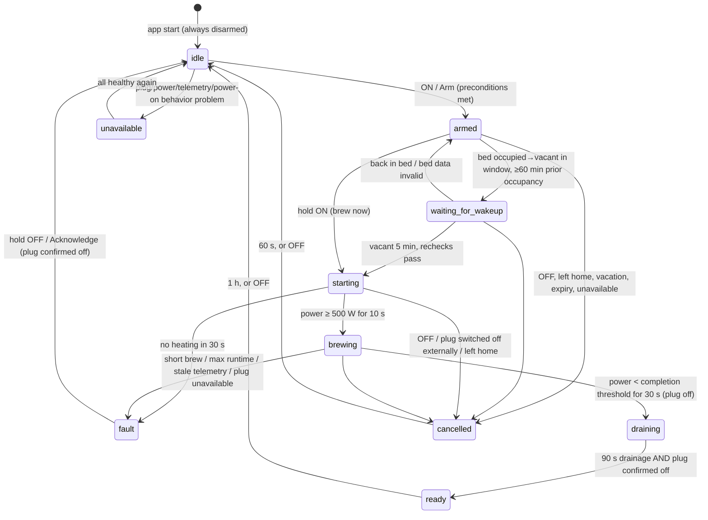

# Coffee station

Source of truth for the kitchen coffee automation. Read this before changing
`appdaemon/apps/coffee_station.py`, the `coffee_station` block in
`private_templates/appdaemon_apps.yaml.tmpl`, `packages/coffee.yaml`, or
`lovelace/dashboards/coffee.yaml`.

**What it does:** you prepare the Moccamaster in the evening and press **ON**
on the IKEA RODRET remote. That arms the station: a one-time confirmation that
the brewer is ready. The next morning, once you have really gotten out of bed,
it brews one pot, watches the plug's power draw to know when heating is done,
switches the plug off, and tells you the coffee is ready.

This switches a ~1.4 kW heating appliance. The appliance's own thermostat and
thermal fuse remain the primary protection. Every software timer here is
defense in depth, not an independent hardware safety device.

## Hardware

| Part | Notes |
| --- | --- |
| Technivorm Moccamaster **KBGT** (thermal carafe, automatic drip-stop) | **120 V, 1400 W (~11.7 A)**. Brews a full 1.25 L carafe in **4–6 min**. The manufacturer recommends brewing **at least 4 cups**. The brewer **powers itself off 12 minutes after brewing**. The manual's start sequence is "plug into grounded outlet, set power switch to ON, brewing will begin quickly", which is what the plug reproduces with the switch left ON. Glass-carafe/hot-plate models use `profile: glass_hotplate`. |
| Eve Energy (Matter over Thread), `20EBU4101` | Reports power, energy and voltage. Eve states it is UL/cULus listed. If the 15 A / 1800 W rating is confirmed on the label, the KBGT uses about 78% of it. That rating needs checking against the label (see *Unverified*). |
| IKEA RODRET E2201 on Zigbee2MQTT | Two buttons. Z2M actions: `on`, `off`, `brightness_move_up`, `brightness_move_down`, `brightness_stop`. |

Brewer facts are from the Moccamaster owner manual and the KBGT product page
(spec sheet supplied by the owner, 2026-11-24).

## Architecture

```
RODRET ──Z2M──▶ sensor.coffee_station_remote_action ─┬─▶ AppDaemon coffee_station (state machine)
Dashboard ──▶ input_button.coffee_*  ────────────────┤        │  publishes sensor/binary_sensor.coffee_*
Phone ──▶ mobile_app_notification_action ────────────┤        │  writes counters / input_number / input_datetime
Bed / presence / vacation / plug / power / voltage ──┘        ▼
                                                     switch.coffee_maker (Matter plug)
                                                               ▲
packages/coffee.yaml (independent of AppDaemon): stop path, 15-min max-on watchdog, start-up shutoff
```

* **`CoffeeCore`** is a pure, deterministic state machine. Inputs are method
  calls with explicit timestamps; outputs are *effects* (plug on/off, timers,
  notifications, counters). It has no Home Assistant dependency, which is what
  the tests drive with simulated clocks and power traces.
* **`CoffeeStation`** is the AppDaemon adapter. Every callback runs under one
  `RLock`, so transitions are serialized even if AppDaemon runs callbacks on
  several threads. Every timer carries a token, so a stale callback from a
  cancelled or replaced timer is ignored even if `cancel_timer` lost a race.
* There is one authoritative state machine. The YAML automations never start
  a brew. They can only switch the plug off.

## State machine



`VALID_TRANSITIONS` in the module is the enforced table. Any other transition
is refused and logged. A fault **latches** until it is acknowledged.

| State | Entry actions | Timers owned (cancelled on exit) |
| --- | --- | --- |
| idle | clear fault | — |
| armed | record armed-at / source / window; arming-expiry timer; notify | arming_expiry |
| waiting_for_wakeup | vacancy debounce timer | arming_expiry, vacancy |
| starting | consume arming; plug ON; notify | startup, heat_confirm, max_energized |
| brewing | record heating start | completion, max_energized |
| draining | plug OFF (thermal) or keep-warm timer (glass); drainage timer | drainage, keep_warm, max_energized |
| ready | counters, metrics, maintenance check; notify | hold, keep_warm, max_energized |
| cancelled | clear arming; notify reason | hold |
| fault | plug OFF + confirmation; notify | — |
| unavailable | clear arming (notify if it was armed) | — |

Shutdown confirmation is independent of state. Every OFF request waits for
the switch to report `off` and the power to read at or below
`idle_threshold_w`. If the power sensor is unavailable, the switch report
alone confirms, and the log says so. It retries every `shutdown_confirm_s`
(15 s) for `shutdown_retries` (3). Eve power reports can trail the on/off
report, so the critical alert comes after about 60 s, not after the first
missed check. It then raises `shutdown_unconfirmed` with a **critical** alert
(iOS critical sound, Android `alarm_stream`) plus a persistent notification
in HA. It keeps re-sending OFF every 60 s, and repeats the critical alert at
most every 15 min until the plug reports off.

A fault latches across restarts: the fault reason is persisted, and only
**hold OFF** or **Acknowledge** clears it.

## Wake-up detection

| Setting | Default |
| --- | --- |
| Morning window (weekday / weekend) | 05:00–11:00 / 05:00–11:00 (`weekday_window`, `weekend_window`, `weekend_days`) |
| Continuous vacancy | 5 min (`vacancy_debounce_s`) |
| Preceding occupancy | 60 min (`min_prior_occupancy_s`) |
| Automatic brews per arming | 1 (`max_auto_brews`) |
| Time zone | America/Chicago |

* Bed source: `input_boolean.master_bed_occupancy`, the canonical owner-bed flag
  the alarms and snooze use. It is fused from `binary_sensor.bayesian_bed_occupancy`
  and the bed-presence pads. `input_boolean.chatgpt_bed_occupied`, named in the
  original brief, **does not exist in the live installation**: its AppDaemon
  app is commented out. If either health entity (Bayesian bed, bed-presence
  pad) is unavailable or unknown, automatic brewing is blocked.
* Only a real **occupied→vacant** transition inside the window qualifies. The
  window opening, a duplicate "vacant" update, or occupancy data recovering
  from `unavailable` never does.
* A trip out of bed shorter than the vacancy debounce does not reset the
  preceding-occupancy clock. Getting up at 06:00 for 3 minutes, then for real
  at 06:40, still brews.
* Overnight bathroom trips fall outside the window. A trip of 5 minutes or
  more inside the window is treated as getting up: a known limitation.
* Arming targets the **next window that has not started**. Arming at 09:00
  targets tomorrow. Arming more than `max_arming_s` (18 h) before that window
  is refused with "Arm after HH:MM".
* Investigated: the iPhone alarm helpers (`input_datetime.weekday_alarm` etc.,
  `specs/alarm_wakeup.allium`) could narrow the window to "near the alarm".
  That is not wired in, because it would duplicate the alarm's workday and
  meeting logic. It is listed under *Future expansion*.
* DST: windows are built from local wall-clock times with `zoneinfo`.
  Durations and expiry use absolute UTC time.

## Arming lifecycle

Arming is a one-time authorization and is **never persisted**. Arming requires:
no latched fault, station available, plug `off` and drawing ≤ 5 W, home, and no
vacation or trip mode. It records `armed_at`, `armed_until` (the earlier of the
window end and armed-at + 18 h), the source and the target window, and sends a
passive notification with a **Disarm** action.

It disarms (moves to `cancelled`) when brewing begins (the arming is consumed),
OFF is pressed, you leave home, vacation or trip mode turns on, the window or
the 18 h limit expires, or the station becomes unavailable. A fault or any
restart also clears it.

## RODRET button mapping

| Button | Z2M action | Behavior |
| --- | --- | --- |
| ON short | `on` | Arm for the next wake-up. A repeat while armed is a no-op. |
| ON long | `brightness_move_up` (+ `brightness_stop` on release) | Brew now. **Only while armed.** Unarmed, it is refused with a notification and the plug is never touched. |
| OFF short | `off` | Disarm, or stop brewing. Works in every state. |
| OFF long | `brightness_move_down` | Stop + disarm + **acknowledge a fault** (only once the plug is confirmed off). |

* The RODRET has **no double-click action**. Z2M reports a double press as two
  `on` (or two `off`) actions, which the 1 s debounce collapses.
* A long press is latched until `brightness_stop` (or 20 s). Repeated
  `brightness_move_*` messages within one hold cannot start a second brew,
  and brew-now is refused once the state machine has left `armed`. Z2M does
  not cache or retain `action`, so nothing is replayed after a reconnect.
  If a stray `brightness_move_up` did arrive while armed, it would be treated
  as a real brew-now, exactly like a press.
* The repo's Z2M convention is the `sensor.*_action` entity, which the live
  Z2M 2.14.3 still provides. Its blank reset (`""`) and `unavailable` are ignored.
  **Dependency:** this is Z2M's *legacy* action sensor, which is deprecated.
  A repeated press only registers because Z2M resets the sensor to `""`
  between presses. The AppDaemon-independent stop
  (`coffee_emergency_stop`) also subscribes to the raw MQTT topic
  `zigbee2mqtt/coffee_station_remote`, so OFF keeps working even if that
  reset or the legacy sensor goes away. The app's arm and brew-now paths
  would then need moving to the MQTT topic or the event entity.

## Power monitoring

| Parameter | Thermal (`thermal_carafe`) | Glass (`glass_hotplate`) |
| --- | --- | --- |
| Heating threshold | 500 W | 500 W |
| Completion threshold | 5 W | 150 W (plate cycling counts as "not heating") |
| Idle threshold (shutdown confirmed, pre-brew) | 5 W | 5 W |
| Startup confirmation timeout | 30 s | 30 s |
| Minimum confirmed heating | 10 s | 10 s |
| Completion debounce | 30 s | 30 s |
| Drainage after heating | 90 s | 90 s |
| Max energized (app) | 12 min | 12 min (+ keep-warm when used) |
| Short-brew threshold | 90 s (a 4-cup minimum brew heats ~2 min) | 90 s |
| Typical heating (progress estimate) | 300 s (full carafe 4–6 min) | 300 s |
| Keep warm after brew | — | `keep_warm_s` (default 0 = plug off at completion) |

**All values are provisional.** Calibrate them from a real brew trace (see
*Commissioning*).

Detected conditions: heating start (and failure to start), short heating
cycles, momentary dips (counted as interruptions, not completion), normal
completion, power-sensor loss, stale telemetry, excessive runtime, the plug
going unavailable, and manual plug activation.

* **Telemetry freshness:** Matter reports power only when it changes, so
  `0.0 W` can sit unchanged for hours. `sensor.coffee_maker_voltage` changes
  often and serves as the liveness signal (`liveness_entities`).
  * Measured on the live plug over 24 h: 666 voltage updates, a median gap of
    84 s and a longest gap of 12 min.
  * Quiet telemetry for more than 30 min (`liveness_max_age_s`) is a *soft*
    issue. It blocks arming and the start of a brew, but **does not cancel an
    existing arming**: a quiet plug overnight must not silently cancel
    tomorrow's coffee.
  * Hard issues cancel an arming: the plug or power sensor unavailable, or
    power-on behavior known and not OFF.
  * While energized, a 120 s gap with no power or voltage update
    (`telemetry_stale_s`) faults and switches off.
  * AppDaemon only sees state *changes*, so a plug re-sending an identical
    value is invisible to it. Calibrate `telemetry_stale_s` from a real
    brew trace.
* **Manual activation** (Eve app, Siri, Apple Home, an Eve schedule, the
  plug's own button): **switched straight back off by default**
  (`manual_activation_policy: shutoff`), even while armed. Only an armed
  station may brew.
  * The opt-in `supervise_if_home` lets such a brew run under every timeout
    above while you are home.
  * Opting in **bypasses one-time arming**, and "home" is a geofence, not
    "standing at the brewer".
  * The app cannot tell the plug's physical button apart from a remote
    command.
* **Energy per brew:** the plug's energy sensor delta, falling back to
  integrating the power samples. Both values are kept in the brew record.

## Safety and failure modes

| Requirement | Implementation |
| --- | --- |
| Power-on behavior OFF | The app sets `select.coffee_maker_power_on_behavior` to `off` and refuses to arm until it reads `off`. (Live value at discovery: **`previous`**.) |
| Explicit one-time arming | Arming is required for every automatic brew and for brew-now. It is consumed when brewing begins and never persisted. A plug switched on any other way is switched back off (default `manual_activation_policy: shutoff`). |
| Home presence | Required to arm and re-checked before starting. Leaving home disarms and (by default) stops an active brew. |
| Device availability + recent telemetry | Checked before arming and before starting; supervised while energized. |
| No unattended retries | A failed or short brew latches a fault. Nothing retries a brew. |
| No brewing after an outage | A plug that returns from `unavailable` already ON raises `energized_after_power_restore` and is switched off. |
| No brewing after initialization | Every app start/reload and Home Assistant reconnect starts disarmed and switches an energized plug off. The YAML `coffee_startup_shutoff` does the same after an HA start. |
| No overlapping brews | One `Brew` at a time. Brew-now and arming are refused in active states. |
| Immediate shutdown on fault + confirmation | Every fault requests OFF and confirms it, with a retry and a critical escalation. |
| Device-local max-on timer | **Not available.** The HA Matter integration exposes no on-with-timed-off or auto-off for this plug. Eve app schedules/auto-off over Matter are unverified. |
| HA watchdog | `coffee_max_on_watchdog`, independent of AppDaemon. If the plug is ON for 15 min, it switches it OFF, confirms, and sends a critical alert if it is still on. If the plug goes **unavailable while ON** for 2 min, it sends a critical "unplug" alert. If it draws **>50 W for 2 min while the switch is not ON** (possible stuck relay), it switches OFF and sends a critical alert. |
| Stop path confirmation | `coffee_emergency_stop` waits up to 30 s for the plug to report off, then sends a critical "unplug" alert (`script.coffee_unplug_alert`). Every YAML OFF step uses `continue_on_error`, so a failed Matter call still reaches the confirmation and alert. |
| Stuck relay | The YAML watchdog's trigger is one sustained combined condition (power >50 W **and** switch not ON for 2 min), so a switch flipping to off while power stays high still starts it. The app re-sends OFF whenever power >50 W while the switch reports off, and escalates to a critical alert if the power does not drop. |
| Never infer water/grounds/carafe from power | Arming is your explicit confirmation of all of them. Power proves heating only. |
| OFF stops in every state | Handled by the app and, independently, by `coffee_emergency_stop`. |

### What happens if a component is down while brewing

| Down | Effect |
| --- | --- |
| AppDaemon | No new brews can start (arming is lost). The YAML stop path still works from the remote (sensor and raw MQTT), dashboard and notifications, and confirms the OFF. The YAML watchdog covers 15 min on, the plug dropping offline while on, and power drawn with the switch off. The Moccamaster ends heating at the end of the reservoir and powers itself off 12 min after brewing. |
| Home Assistant | Nothing in HA can switch the plug. **The plug's own button** and the brewer's rocker still work. The Moccamaster finishes on its own thermostat and switches itself off 12 min after brewing. On restart, `coffee_startup_shutoff` switches an energized plug off and confirms it (or says it could not see the plug), and the app does the same. If HA first saw the plug as unavailable and then ON, the app also latches `energized_after_power_restore`, so two notices arrive and the fault needs acknowledging. |
| MQTT / Zigbee2MQTT / Zigbee coordinator | The remote stops working; the dashboard and notification actions still work. The plug is Matter, so supervision continues. Z2M does not replay button actions after a reconnect. |
| Thread / Matter (plug unreachable) | The app faults (`plug_unavailable_during_brew`, critical) if the plug may be energized. The YAML watchdog independently sends a critical alert after 2 min unavailable-while-ON, which covers AppDaemon also being down. **Unplug it.** When the plug returns ON, it is switched off. |
| Mains power outage | The plug and brewer lose power. On return, power-on behavior OFF keeps the plug off. If it comes back ON anyway, the app switches it off and faults, but only if HA saw the plug go unavailable. A blip too short for HA to notice is covered only by power-on behavior OFF and the brewer's own controls. |

## Home Assistant entities

**Published by the app.** These are runtime entities created with
AppDaemon's `set_state`, and they are re-published on every app start and HA
reconnect.

| Entity | Notes |
| --- | --- |
| `sensor.coffee_state` | State machine state. Attributes: last_transition, transition_reason, last_ignored, arming_source, armed_at/until, window_start/end, brew_trigger_source, brew_elapsed_s, brew_progress, last_power_w, telemetry_age_s, peak_power_w, fault_reason, last_fault_reason, last_successful_brew, last_brew record, shutdown_pending, issues. |
| `binary_sensor.coffee_armed`, `coffee_brewing`, `coffee_ready`, `coffee_station_available`, `coffee_maintenance_due` | Convenience flags. `coffee_station_available` carries `issues`. |
| `sensor.coffee_fault` | Current latched fault reason, or `none`. |
| `sensor.coffee_armed_at`, `coffee_armed_until`, `coffee_next_window` | Timestamps. |
| `sensor.coffee_brew_progress` | Percent, estimated from heating time vs `typical_heating_s`. |

**Icons follow the state.** Each `sensor.coffee_state` state has its own
Material Design Icon (`STATE_ICONS` in the module):

| State | Icon |
| --- | --- |
| idle | `mdi:coffee-maker-outline` |
| armed | `mdi:coffee-maker-check` |
| waiting_for_wakeup | `mdi:coffee-maker-check-outline` |
| starting | `mdi:power-plug` |
| brewing | `mdi:coffee-maker` |
| draining | `mdi:water-outline` |
| ready | `mdi:coffee` |
| cancelled | `mdi:coffee-off-outline` |
| fault | `mdi:alert-octagon` |
| unavailable | `mdi:coffee-off` |

Each binary sensor switches between an on and an off icon (`BINARY_ICONS`).
For example, armed shows `coffee-maker-check` and disarmed shows
`coffee-maker-outline`; ready shows `coffee` and not ready shows
`coffee-outline`. The plug itself has no customized icon, because a
customized icon never changes. Its `outlet` device class makes HA show
power-plug / power-plug-off.

**Helpers in `packages/coffee.yaml`** (restored across restarts). These are
the repo's equivalents of the proposed names.

| Proposed | Implemented |
| --- | --- |
| `input_boolean.coffee_armed` | `binary_sensor.coffee_armed` (app-owned: a persisted boolean could be restored after a restart, which is forbidden) |
| `button.coffee_arm` / `brew_now` / `stop` / `reset_maintenance` | `input_button.coffee_arm`, `coffee_brew_now`, `coffee_stop`, `coffee_reset_maintenance`, plus `coffee_acknowledge_fault` |
| `counter.coffee_total_brews` | `counter.coffee_total_brews` |
| `sensor.coffee_brews_since_descale` | `counter.coffee_brews_since_descale` |
| — | `counter.coffee_failed_brews` (failed or interrupted) |
| `sensor.coffee_last_brew`, `_duration`, `_energy` | `input_datetime.coffee_last_brew`, `input_number.coffee_last_brew_duration` (s), `coffee_last_brew_energy` (Wh), `coffee_last_brew_peak_power` (W) |
| — | `input_datetime.coffee_last_descale` |
| averages | `sensor.coffee_average_brew_heating_time`, `coffee_average_brew_energy`, `coffee_average_peak_power` (`statistics`, last 30 brews / 180 days) |
| `switch.coffee_maker`, `sensor.coffee_maker_power`, `sensor.coffee_maker_energy` | The Eve plug's own entities after the commissioning rename. Its lifetime energy sensor provides cumulative consumption. |

## Notifications

Notifications go through `notify.all` with tags, `url`/`clickAction` set to
`/db-coffee/coffee`, and a **Coffee** URI button.

| Tag | Events | Level |
| --- | --- | --- |
| `coffee_station` | armed (**Disarm** action), arming cancelled/expired/refused, brewing started (**Stop coffee** action), coffee ready, restart disarmed | passive, except *ready* (active) and skipped-auto-brew (time-sensitive) |
| `coffee_station_fault` | failed to start, short brew, excessive runtime, stale/lost telemetry, plug unavailable, energized after restore, manual activation shut off, start-up shutoff | time-sensitive; **critical** for shutdown-unconfirmed and plug-unavailable-while-energized |
| `coffee_station_maintenance` | descale due (once per due period) | passive |

Each tag replaces its previous notification, so the lifecycle produces one
notification on the phone at a time. `docs/notification_policy.md` asks for
pushes only when action is needed. The armed, brewing and ready notices were
explicitly requested for this feature and are kept passive. Remove their
`_notify` calls if they turn out to be noise.

## Maintenance

* Counts successful brews, brews since descale, and failed or interrupted
  brews. It stores per-brew heating time, energy and peak power, and keeps
  rolling averages of each.
* Descale due: `descale_brews` (100) **or** `descale_days` (90) since
  `input_datetime.coffee_last_descale`. This is the manufacturer's interval:
  "Descale your brewer every 100 cycles … or a minimum of every three months"
  (owner manual). The manual makes regular descaling a **warranty
  condition** and recommends Urnex/Durgol, not vinegar. After descaling, run
  2 full reservoirs of plain water, then press **Reset after descaling**.
  Shorten the interval for hard water. Descaling and rinse cycles are run
  manually and are not counted as brews.
* There is no scale diagnosis: heating time also depends on brew volume, and
  the relationship has not been validated. Watch the average heating-time
  trend only as a hint.

## Dashboard

`lovelace/dashboards/coffee.yaml`, registered as `db-coffee` (sidebar
**Coffee**). Sections: status (state summary, availability, progress, fault),
controls, power (live power and a 2-hour history), last brew and averages,
and maintenance.

* **Stop** is always visible.
* **Arm** is shown only in idle, ready or cancelled.
* **Brew now** is shown only while armed or waiting.
* **Acknowledge** is shown only in fault.

## Configuration

Everything device-specific lives in the `coffee_station` block of
`private_templates/appdaemon_apps.yaml.tmpl`. The presence entity comes from
the private mapping, and there are no secrets or MQTT credentials. Minimal
example:

```yaml
coffee_station:
  module: coffee_station
  class: CoffeeStation
  switch_entity: switch.coffee_maker
  power_entity: sensor.coffee_maker_power
  energy_entity: sensor.coffee_maker_energy
  liveness_entities: [sensor.coffee_maker_voltage]
  power_on_behavior_entity: select.coffee_maker_power_on_behavior
  remote_action_entity: sensor.coffee_station_remote_action
  bed_entity: input_boolean.master_bed_occupancy
  bed_health_entities: [binary_sensor.bayesian_bed_occupancy]
  presence_entity: binary_sensor.example_home
  vacation_entities: [binary_sensor.planned_vacation_calendar, input_boolean.trip]
  notify_service: notify/all
  profile: thermal_carafe        # or glass_hotplate
  # feedback_light: light.kitchen  # optional short flash on arm / ready
```

The required keys are `switch_entity`, `power_entity`, `bed_entity`,
`presence_entity` and `notify_service`. Without them the app logs an error and
stays disabled. Every other key, including all thresholds, windows, timeouts
and maintenance intervals, is optional; the full list with live values is in
the template.

## Installation

1. Merge to `develop`. Pull it on the HA host.
2. **Rename the entities** (Settings → Entities). Nothing referenced the old
   IDs at the time of writing:
   * `switch.eve_energy_20ebu4101_2` → `switch.coffee_maker`
   * `sensor.eve_energy_20ebu4101_power_3` → `sensor.coffee_maker_power`
   * `sensor.eve_energy_20ebu4101_energy_3` → `sensor.coffee_maker_energy`
   * `sensor.eve_energy_20ebu4101_voltage_3` → `sensor.coffee_maker_voltage`
   * `select.eve_energy_20ebu4101_power_on_behavior_on_startup_2` → `select.coffee_maker_power_on_behavior`
   * In Zigbee2MQTT, rename the RODRET's friendly name to `coffee_station_remote`
     (with "update Home Assistant entity ID"), giving
     `sensor.coffee_station_remote_action`.
3. Check the configuration, then restart Home Assistant (this adds the
   package and the dashboard).
4. Render and push AppDaemon: `python3 scripts/render_private_config.py`, then
   `python3 scripts/render_private_config.py --check`, then
   `python3 scripts/appdaemon_sync.py push` (see `docs/appdaemon_sync.md`).
5. Confirm `sensor.coffee_state` shows `idle` (or `unavailable` with a clear
   `issues` attribute).

## Commissioning checklist (physical, supervised)

Stay with the brewer for every step.

- [ ] Confirm the brewer is a KBGT and that its switch is a rocker that
      stays ON when external power is cut and restored, with no momentary
      power button.
- [ ] **Auto-off latch test:** brew once and let the brewer's own 12-minute
      auto-off happen. Switch the plug OFF, leave the rocker ON, then
      switch the plug ON. Does it start heating without touching the
      switch? Record the answer here; if it does not, automatic brewing
      cannot work as designed.
- [ ] Read the plug's label: rating ≥ the brewer's nameplate wattage at 120 V.
      Record both. Confirm the plug and the outlet are not shared with
      another high load.
- [ ] `select.coffee_maker_power_on_behavior` reads `off` (the app sets it).
      Pull the plug out of the wall and reinsert it: it must stay OFF.
- [ ] RODRET: press and hold each button and watch the action sensor history.
      Confirm the `on`, `off`, `brightness_move_*` and `brightness_stop`
      actions, and whether the move action repeats while held.
- [ ] Unarmed, hold ON: nothing happens, and a "not armed" notice arrives.
- [ ] **Calibration brew** (full reservoir, brewer attended): arm, hold ON.
      Record the power trace (peak W, heating duration, the tail at the end,
      the update interval during heating) from the dashboard history. Adjust
      `heating_threshold_w`, `completion_threshold_w`, `typical_heating_s`,
      `short_brew_s`, `max_energized_s` and `telemetry_stale_s`, keeping
      clear margins above the measured values.
- [ ] Time the basket's drip after the element stops; set `drainage_s`.
- [ ] Mid-brew, press OFF: the plug switches off at once, the state becomes
      cancelled, and Stop works from the dashboard too.
- [ ] Stop AppDaemon, then press OFF on the remote: the plug still switches
      off (YAML path).
- [ ] Start a brew with no water: a `short_brew` or `failed_to_start` fault
      arrives and the plug turns off.
- [ ] Turn the plug on from the Eve app: it is switched straight back off
      and a "switched off" notice arrives (the default `shutoff` policy).
- [ ] Remove any Eve/Apple Home schedules or automations on the plug
      (multi-admin): only the coffee station may switch it on.
- [ ] With AppDaemon stopped: the dashboard Stop button and the
      notification **Stop coffee** action both switch the plug off.
- [ ] With HA stopped: the plug's own button switches it off.
- [ ] Press OFF on the remote twice, 5 s apart: `coffee_emergency_stop`
      shows two traces (sensor and MQTT triggers).
- [ ] Watch the plug, cord and outlet during a full brew: none gets more
      than warm. Nothing else high-load shares the circuit.
- [ ] Mid-brew power cut (switch the breaker or unplug the plug from the
      wall), then restore: the plug stays OFF.
- [ ] Empty reservoir with the rocker ON: a `short_brew`/`failed_to_start`
      fault arrives. Rocker OFF: a `failed_to_start` fault arrives.
- [ ] Critical alerts: they break through Focus/Do Not Disturb on every
      phone in `notify.all`. On Android this needs the `alarm_stream` channel
      allowed.
- [ ] One supervised automatic morning: arm in the evening, get up normally,
      and confirm it brews about 5 minutes after leaving bed.

## Rollback

1. Remove the `coffee_station` block from `apps.yaml` (or set the app
   `disable: true`) and push AppDaemon. The app's entities disappear on the
   next HA restart.
2. Remove `packages/coffee.yaml` and the `db-coffee` dashboard entry, check
   the configuration, and restart HA.
3. Optionally rename the entities back. No other automation depends on them.
   The plug keeps working from the Eve app; leave its power-on behavior at
   `off`.

## Known limitations

* A trip out of bed of 5 minutes or more inside the morning window counts as
  getting up.
* AppDaemon-published entities have no `unique_id`, so they cannot be renamed
  in the UI, and they vanish until the app re-publishes after an HA restart.
* The rolling averages skip a brew whose stored value equals the previous one.
* Brew progress is an estimate from heating time.
* There is no device-local max-on timer (see *Safety*).
* The power thresholds are provisional until a commissioning brew trace
  confirms them. The descale interval comes from the manual.

## Unverified / needs physical verification

* **KBGT auto-off and external power (most important).** The brewer "will
  power off automatically 12 minutes after brewing". It is not documented
  whether that auto-off latches: whether, with the rocker still in the ON
  position and the plug's power restored, the next brew starts by itself or
  the switch has to be cycled OFF→ON first. If it latches, every automatic
  brew would end in `failed_to_start`. The fault is safe, but the feature
  would not work. Commissioning must test this. The workaround would be
  adding "cycle the brewer switch OFF→ON while the plug is off" to the
  arming routine, and only if that is safe and works.
* The manual says "Unplug from outlet when not in use." A smart plug that
  opens the circuit is not literally unplugging it. Keeping the plug OFF
  except while brewing (enforced here) is the closest equivalent; it is your
  call whether that is acceptable.
* Eve Energy US load rating (15 A / 1800 W came from a summarized page, not
  the label) and whether Eve's own schedules or auto-off run locally over
  Matter.
* The RODRET hold-repeat behavior (the Z2M docs list one `brightness_move_*`
  plus `brightness_stop`).
* Matter power-report cadence during steady heating (sets `telemetry_stale_s`).

## Future expansion

The core takes inputs as plain method calls and checks preconditions in one
place (`_brew_blocker` / `_wakeup_blocker`). Additional sensors become extra
inputs and blockers there, without restructuring the state machine. Examples:

* reservoir load cell: block when the water is low
* carafe presence/weight: block when there is no empty carafe
* basket contact sensor
* kitchen occupancy: e.g. require it within N minutes after `ready`
* an alarm-anchored or adaptive window: narrow `window_for()`
* brew volumes: a per-arming profile
* consumption analytics from the recorded brews
